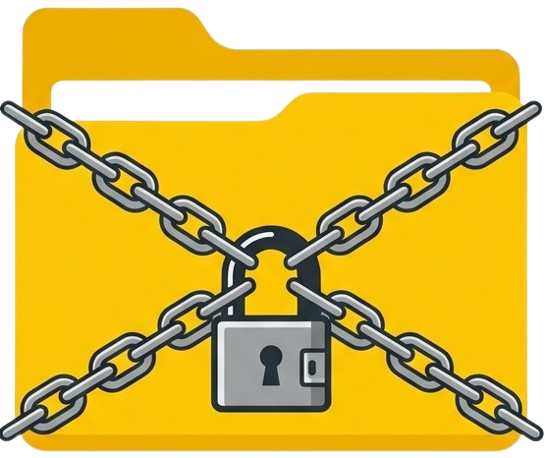
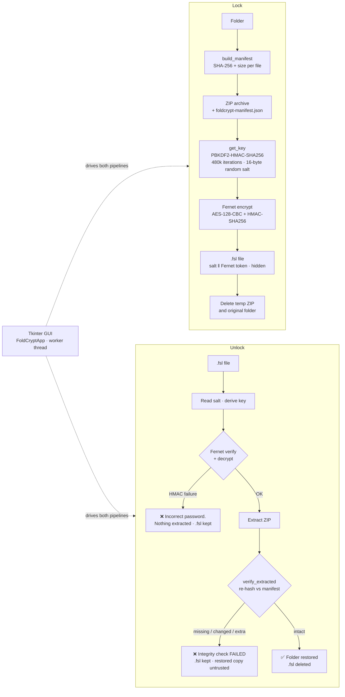

<p align="center">
  
</p>

# 🛡️ FoldCrypt

**Encrypt any folder into a single portable, password-locked `.fsl` file — and prove, on unlock, that every file inside came back exactly as it went in.**

FoldCrypt is a cross-platform desktop locker written in Python. It does not rely on folder permissions or hidden-folder tricks: the folder is archived, the archive is encrypted with **Fernet** (AES-128-CBC + HMAC-SHA256) under a key derived from your password with **PBKDF2-HMAC-SHA256 (480,000 iterations, fresh 16-byte random salt per lock)**, and a **SHA-256 integrity manifest** of every file is embedded inside the encrypted archive. On unlock, the restored folder is re-hashed against that manifest — if anything is missing, changed or unexpected, FoldCrypt fails loudly and keeps the `.fsl` instead of handing back a subtly wrong folder with a "success" message.

**Repository:** [github.com/Manoj-2424150118/FoldCrypt](https://github.com/Manoj-2424150118/FoldCrypt) · **License:** MIT · **Platforms:** Windows, Linux, macOS (Python 3.8+)


---

## Overview

Sensitive folders are usually "protected" by an OS account password or a hidden-folder setting — both of which evaporate the moment the drive is mounted elsewhere or the files are copied. FoldCrypt protects the *bytes themselves*:

- **Lock** a folder in the GUI and it is replaced by one hidden `.fsl` file that can be moved to a USB drive, another computer or cloud storage, and unlocked anywhere with the password.
- **Unlock** verifies twice: Fernet's HMAC proves the encrypted blob is untouched, and the embedded SHA-256 manifest proves the *extracted folder tree* is complete and identical to what was locked.
- **No password recovery, by design.** A wrong password fails Fernet's authentication check and nothing is decrypted.

> ⚠️ **Read this first:** locking a folder deletes the original unencrypted folder, and a successful unlock deletes the `.fsl` file. Keep a backup of anything irreplaceable, and never lose the password — without it the data cannot be recovered.

### Features

- **Authenticated encryption** — Fernet (AES-128-CBC with an HMAC-SHA256 tag) via the `cryptography` library; tampering with a `.fsl` is detected on unlock instead of silently producing corrupt output.
- **Integrity-verified restore** — a manifest (`foldcrypt-manifest.json`: SHA-256 + size for every file, keyed by POSIX relative path) is embedded in the encrypted archive at lock time and fully verified after extraction. Archives locked by older versions (no manifest) still unlock normally, with verification skipped and reported.
- **Salted, iterated key derivation** — PBKDF2-HMAC-SHA256, 480,000 iterations, fresh 16-byte `os.urandom` salt per lock, so the same password never derives the same key twice.
- **Portable single file** — the `.fsl` is self-contained (salt prefixed, everything else encrypted) and OS-independent.
- **Unobtrusive output** — on Windows the `.fsl` receives the system *hidden* attribute; on other platforms it is written with a leading dot (`.<folder>.fsl`).
- **Refuses to destroy data** — locking refuses if a `.fsl` for that folder already exists or the folder contains the reserved manifest filename; unlocking refuses to overwrite an existing folder, and keeps the `.fsl` if integrity verification fails.
- **Purpose-built GUI** — Tkinter interface with Lock/Unlock tabs, deterministic progress bar, show/hide password eye icons, auto-closing result dialogs, and (on Windows) Explorer selection of the produced item. Missing image assets degrade gracefully to text/emoji fallbacks.

---

## Architecture

Everything lives in `main.py`: the cryptographic core (`get_key`, `lock_folder`, `unlock_file`, `build_manifest`, `verify_extracted`) is GUI-independent and headlessly testable; the Tkinter layer (`FoldCryptApp`) runs the core on a worker thread and reports progress through a callback.



### `.fsl` file format

```
┌────────────────────┬───────────────────────────────────┐
│ Salt (16 bytes)    │ Fernet token (encrypted ZIP data) │
└────────────────────┴───────────────────────────────────┘
```

The salt is stored in the clear as the first 16 bytes — it is not secret; it only needs to be unique per lock. Everything after it — including the ZIP archive and the integrity manifest — is inside the Fernet ciphertext.

---

## Threat model

| Assets | Adversaries | Mitigations |
|---|---|---|
| Folder contents at rest (confidentiality) | Anyone who obtains the `.fsl` file — lost USB drive, shared cloud folder, copied backup | Fernet authenticated encryption (AES-128-CBC + HMAC-SHA256); the file reveals nothing without the password |
| The password / derived key | Offline brute-force and dictionary attackers working on a stolen `.fsl` | PBKDF2-HMAC-SHA256 with 480,000 iterations and a fresh 16-byte random salt per lock; identical passwords in different locks derive unrelated keys |
| Restored folder integrity | Bit rot, short writes, failing disks, partial extraction, tampering in transit or storage | SHA-256 + size manifest embedded *inside* the encrypted archive; unlock re-hashes every restored file and fails loudly — keeping the `.fsl` — on any missing, changed or unexpected file |
| The encrypted blob itself | Anyone modifying the `.fsl` to corrupt or probe the contents | Fernet's HMAC-SHA256 tag is verified before decryption completes; a wrong password or a flipped bit produces "Incorrect password. Access Denied." and extracts nothing |
| The user's only copy of the data | Accidents: overwriting, name collisions, half-finished operations | Lock refuses when a `.fsl` already exists or the reserved manifest name is present; unlock refuses to overwrite an existing folder and keeps the `.fsl` on any verification failure |

**Out of scope / honest limitations:** malware or a keylogger on the machine while the folder is unlocked or the password is typed; an attacker with access to the *unlocked* folder; weak passwords (PBKDF2 slows guessing, it cannot rescue `123456`); and the hidden attribute/dot-prefix, which is cosmetic unobtrusiveness, **not** a security control. Deletion of the original folder on lock is permanent — keep backups.

---

## Tech stack

| Layer | Technology |
|---|---|
| Language | Python 3.8+ (standard library: `zipfile`, `hashlib`, `json`, `threading`, `pathlib`) |
| GUI | Tkinter (`ttk` notebook, progress bar, file dialogs) — ships with Python |
| Cryptography | `cryptography` ≥ 42.0.0 — Fernet (AES-128-CBC + HMAC-SHA256) and PBKDF2HMAC |
| Integrity | SHA-256 manifest (`foldcrypt-manifest.json`, format version 1) embedded in the encrypted archive |
| Tests | stdlib `unittest` — 11 headless tests, no GUI required |
| License | MIT |

---

## Setup & run

### Prerequisites

- Python 3.8 or higher, with Tkinter (included in standard python.org and most OS Python installs).
- The only third-party dependency is `cryptography`, declared in `requirements.txt`.

### Install

```bash
git clone https://github.com/Manoj-2424150118/FoldCrypt.git
cd FoldCrypt
pip install -r requirements.txt
```

Keep `logo.png`, `eye_open.png` and `eye_closed.png` in the same directory as `main.py` — the GUI loads them from there (and falls back to text/emoji icons if they are missing).

### Run

```bash
python main.py        # any platform
pythonw main.py       # Windows: same, without a background console window
```

### Use

**Lock a folder:** open the **Lock Folder** tab → **Browse** to the folder → enter the password twice (eye icons show/hide it) → **Lock**. The folder is archived, encrypted and replaced by the hidden `.fsl` in the same directory.

**Unlock a folder:** open the **Unlock Folder** tab → **Browse** to the `.fsl` file → enter the exact password → **Unlock**. The blob is authenticated and decrypted, the folder is extracted and verified against its manifest, and only then is the `.fsl` removed.

---

## Testing

The cryptographic core is tested headlessly — no GUI is launched:

```bash
pip install -r requirements.txt
python -m unittest discover -s tests -v    # 11 tests
```

| Test file | Covers |
|---|---|
| `tests/test_lock_unlock.py` (5 tests) | Key derivation (deterministic per password+salt, salt/password sensitivity, 32-byte key); full lock→unlock round-trip restoring exact bytes; wrong password refused with the `.fsl` kept; lock refused when a `.fsl` already exists |
| `tests/test_integrity_manifest.py` (6 tests) | Manifest build/verify units; tampered, missing and unexpected-extra file detection; reserved manifest-name refusal; full round-trip leaving no manifest behind; legacy (pre-manifest) archives still unlock |

---

## Project structure

| File | Purpose |
|---|---|
| `main.py` | The whole application — key derivation, manifest build/verify, lock/unlock engine, and the Tkinter GUI (`FoldCryptApp`) |
| `requirements.txt` | Python dependencies (just `cryptography`) |
| `logo.png` | App / window icon |
| `eye_open.png` / `eye_closed.png` | Password-visibility toggle icons (text/emoji fallback if missing) |
| `tests/test_lock_unlock.py` | Headless lock/unlock core tests |
| `tests/test_integrity_manifest.py` | Headless integrity-manifest tests |
| `LICENSE` | MIT License |

---

## Troubleshooting

- **"A locked file for this folder already exists."** — a `.fsl` file with the same folder name is already in that directory. Unlock or move it before locking again.
- **"A folder named '…' already exists here."** — unlocking would overwrite an existing folder, so FoldCrypt refuses. Move or rename that folder first.
- **"Incorrect password. Access Denied."** — the password doesn't match the one used to lock the file (Fernet HMAC verification failed). Passwords are case-sensitive and there is no reset option.
- **"Integrity check FAILED…"** — the restored files do not match the lock-time manifest (missing, changed or extra files). The `.fsl` has been kept; do not rely on the restored copy — unlock again from an undamaged `.fsl`.
- **"'foldcrypt-manifest.json' is reserved…"** — a file with the manifest's name sits at the top of the folder you tried to lock. Rename it and retry.
- **The window opens without icons** — make sure `logo.png`, `eye_open.png` and `eye_closed.png` sit next to `main.py`; the UI falls back to text/emoji icons if they are missing.

---

## Security

FoldCrypt's security design is documented above (architecture, `.fsl` format, threat model). Its guarantees rest on the `cryptography` library's Fernet and PBKDF2 implementations — FoldCrypt rolls no primitives of its own.

**Reporting a vulnerability:** please do not open a public issue for a security flaw. Report it privately following the maintainer's security policy in **[SECURITY.md](SECURITY.md)** (GitHub private vulnerability reporting). Two standing cautions bear repeating: there is **no password recovery**, and locking **permanently deletes the original folder** — FoldCrypt is a locker, not a backup tool.

## Author

**Manoj Kumar Sharma** — Cybersecurity & Software Professional · Jaipur, India
MCA, Manipal University Jaipur · EC-Council Ethical Hacking Essentials · Google Cybersecurity Professional Certificate

## License

MIT — see [LICENSE](LICENSE) for details.
